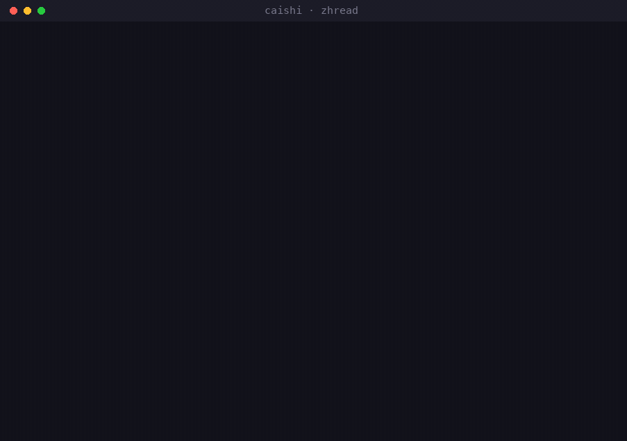

# Caishi: Chinese-internet capabilities for AI

> Author: ZhongQuinnKing (primary account)
> License: see [LICENSE](LICENSE) (layered: code MIT, content and docs CC BY-NC-ND 4.0; five terms: free to use / free to self-modify / attribution required when redistributing / prior authorization required to publish a modified version / no commercial exemption — the license itself grants no commercial rights)
> Commercial licensing and collaboration: contact hello@xinchuan.dev for written authorization (subject: [Commercial license] or [Adaptation license])

> **TL;DR**: A capability pack that lets AI agents read the Chinese internet:
> Douyin, Bilibili, Xiaohongshu, WeChat Official Accounts, Zhihu, Toutiao + 30+ academic /
> developer / lifestyle sites. Read-only, reuses your own browser sessions, one link at a time —
> no scraping at scale.

Chinese version: [README.md](./README.md)（中文版）

Point your AI's eyes at the Chinese internet. Douyin, Xiaohongshu, Bilibili, Weibo, Zhihu, WeChat Official Accounts, Toutiao: read a piece of content with a single command. Built for command-line-capable agents such as Claude Code.

Repository: https://github.com/ZhongQuinnKing/caishi (a platform changes, a command stops working, open an issue).

It is not a scraper and it does not work in bulk. Every request travels through your own browser session (the opencli browser bridge), reusing the accounts already signed in on that browser, the same as if you were reading in the browser yourself.

## What it can do

| Platform | In one line | Command (example) |
|------|--------|--------------|
| Douyin | Single-link full extract: caption / author / four engagement counts / publish time / duration / watermark-free download URL | `opencli douyin detail "<share link>" -f yaml` |
| Douyin | Comments on any video (text / likes / author / reply count) | `opencli douyin comments "<link>" --limit 20` |
| Douyin | Search; a user's works list | `opencli douyin search "term"` / `user-videos <sec_uid>` |
| Xiaohongshu | Search (in-house; sidesteps known bugs in the official one) | `opencli xiaohongshu find "term" --limit 10` |
| Xiaohongshu | Full note extract (in-house: title / body / engagement / image set) / saved list | `opencli xiaohongshu read "<link>"` / `saved` |
| Bilibili | Search / detail / trending; subtitles; official AI summary | `opencli bilibili search "term"` / `subtitle BVxxx` / `summary BVxxx` |
| Weibo | Hot search | `opencli weibo hot` |
| Zhihu | Read an answer / a column and export Markdown | `opencli zhihu answer-detail <id>` / `download --url ...` |
| WeChat Official Accounts | Sogou search; export an article as clean Markdown | `opencli weixin search "term"` / `weixin download --url ...` |
| Toutiao | Hot list, recommendation feed (no login, no browser) | `opencli toutiao hot` |
| Sheet music | IMSLP public-domain score library: search, list a work's files (in-house) | `opencli imslp search "Chopin"` / `files <id>` |
| Sheet music | Tan8: pop score search, page preview images (in-house; full scores are a site membership feature and are not bypassed) | `opencli tan8 search "title"` / `sheet <id>` |
| Academic | dblp: paper / author / venue search (in-house; the browser build slips past the anti-bot shield automatically) | `opencli dblp find "keyword"` / `author` / `venue` / `paper` |
| Web | Read the main text of any page (in-house; body converted to plain text, long pages cut at 60,000 characters) | `opencli web read "<url>"` |

In-house additions make up nine pieces covering 14 commands (Douyin detail / comments / collection, Xiaohongshu find / read, IMSLP and Tan8 scores, dblp academic search, and web-page text reading): the command-line pieces ship inside the `clis/` directory and are in place as soon as you install, and the web route arrives with opencli's official adapters; the other platform commands come from opencli's official adapters. Per-platform test status and known pitfalls are in [`platform-status.en.md`](./platform-status.en.md).

### AI-first clients (MCP)

AI that cannot run shell commands is not left out. The standalone package [`caishi-mcp`](./caishi-mcp/) is a self-contained MCP server (the protocol layer is implemented in the package itself, with no MCP SDK dependency; the browser engine installs with it), so any MCP client works: Claude Desktop, Cursor, Codex, DeepSeek Harness and others all reach the same capabilities (the same browser, the same signed-in session). Four site commands (Bilibili video / Douyin detail / Xiaohongshu note / any web page): `npm install -g caishi-mcp`. Setup and limits are in [caishi-mcp/README.md](./caishi-mcp/README.md) and [MCP.en.md](./MCP.en.md).

### Three companion utilities

- **`zhread "<link>"`**: read the Chinese internet with one command. It detects the platform (Douyin / Bilibili / WeChat Official Accounts / Zhihu / Xiaohongshu / score sites) and prints a uniform Markdown shape; `--save DIR` writes it to a file. This is the one that crosses platforms.

  

  *Real recording: `zhread` reads a Bilibili video in one command. Wait phase compressed; output uncut.*
- **`zhcheck`**: platform health check. A light pass by default (it probes only the browser bridge, opening no pages); `--deep` probes platform by platform (it opens each platform's pages in turn and warns beforehand). When a platform breaks, run this first.
- **`zhupdate`**: update and repair. It compares against the latest remote version, then for a git install pulls and re-runs the deploy; for problems it cannot fix it hands you a report template. Platforms redesign often, and a fixed build can land the same day. One checks, one fixes.

## Install

Prerequisite: macOS (or any desktop OS that can run Node) plus Chrome/Chromium.

1. Run `bash install.sh` (installs opencli, downloads the browser extension files, and installs the in-house commands).
2. One manual step: in Chrome open `chrome://extensions`, turn on Developer mode, choose "Load unpacked", and pick `~/.opencli/extension`. The script prepares the extension files; a store install also works.
3. Sign in to platforms as needed: open the site in that same browser and scan the QR code once (valid long-term).

## Usage (one line for your AI)

> "Take a look at what this Douyin video says https://v.douyin.com/xxxx/"
> "Search Xiaohongshu for piano teaching and list the first few results"
> "Export this WeChat article as markdown"

The agent picks the matching command from the table above on its own.

## Using it on domestic AI (Doubao, etc.)

The `skills/zh-web` skill bundled here is cross-environment, so domestic AI can install it too:

1. Download this repository and drag the `skills/zh-web` folder (it contains SKILL.md) into Doubao's "My Skills", or tell Doubao: "please install this skill: https://github.com/ZhongQuinnKing/caishi".
2. Once installed it inspects the environment on its own: where commands can run (Claude Code / Codex and the like) it takes the full command path; where only chat is available (Doubao and others) it takes the "no-command path", borrowing the AI's own web access to read public pages, and where a page cannot be read it says so plainly and asks you to paste the text or a screenshot.

One sentence: **deep reads (comments, saved items, subtitles, exports …) need a command-line environment; what a chat-only environment can reach is spelled out per platform in the skill.**

## Known pitfalls and ground rules (important, read before use)

- **Your instruction is the only trigger**: installing opens no web page on its own. A platform page appears only when you explicitly ask to use it: ask for one, one opens; ask for three, three open; anything you did not ask for stays closed. Sign-in works the same way, on demand.
- **Read-only, no bulk, no interaction.** Keep the frequency modest; account safety comes first, and the tool will not carry responsibility on your behalf.
- **Sign in with a test or secondary account**, not your main one.
- **Xiaohongshu sessions are short-lived**: closing the browser drops the login, so keep the browser open while you use it. If you hit its "too many devices" risk control, wait a day or two before signing in again.
- Douyin, Xiaohongshu and similar platforms redesign often, so an endpoint can stop working; if it breaks, open an issue.
- The pack leaves out platforms that need a VPN (YouTube, Twitter and the like); they are out of scope.

## Sibling projects

Three more free, open-source projects in the same family:

- [Yesong](https://github.com/ZhongQuinnKing/yesong): an offline information sentry. It watches the world (trending lists / GitHub activity / HN) while your AI sleeps, at zero cost and without calling a large model.
- [Shiji](https://github.com/ZhongQuinnKing/shiji): a strategist from senior year of high school to the office desk, a growth advisor you install into an AI assistant, 152 pieces spanning twelve tracks such as college applications, university, grad school, civil-service exams, job hunting, career, theses and studying abroad.
- [Yuchi](https://github.com/ZhongQuinnKing/yuchi): a ruler for Chinese writing. It measures rhythm, flags stock phrases and marks tone patterns; a piece of prose or a poem can both go through it (a handy tool for self-review after drafting).

## Compliance and disclaimer

- This pack is a reading tool for **personal study and research**: read-only, single-item, low-frequency.
- Do **not** use it for bulk collection, commercial purposes, or any scenario that breaks the service terms of the platform involved.
- The tool breaks no technical measure (request signing happens inside the platform's own page) and bypasses no paid or membership content.
- You are responsible for your own use; any consequence arising from using this tool falls on the user.

## Standing on whose shoulders

The core runtime is [opencli](https://github.com/jackwener/opencli) ("turn any website into a CLI"). This pack does three things: it runs real tests against Chinese platforms, fills in the missing commands (nine in-house pieces, 14 commands), and writes down the sign-in and pitfall experience as a manual.

## Status

The name comes from the Book of Han: "so he established the Music Bureau, to gather songs and recite them by night", collecting the voices of the Chinese internet and offering them to the AI that needs them. The first release covers read access to seven platforms: Douyin / Bilibili / Xiaohongshu / Weibo / Zhihu / WeChat Official Accounts / Toutiao.
